# 케어로그

원광장애인종합복지관 돌봄 일지 작성 앱입니다.

화면은 실제 백엔드 `welfare-be`를 호출합니다. 브라우저 mock 서버는 없으며 백엔드와 PostgreSQL이 실행되어 있어야 합니다.

- [실제 화면이 포함된 사용자 매뉴얼 PDF](docs/케어로그_사용자매뉴얼.pdf)
- [수정 전후와 기능·코드 개선점](docs/초기-main-수정전후와-개선점.md)
- [main 통합 변경 사항](docs/main-update-2026-11-07.md)

## 동작 확인

**배포 주소: <https://welfare-fe.vercel.app>**

아래 화면은 배포본과 같은 코드를 로컬 서버와 로컬 PostgreSQL에서 실행해 찍었습니다(2026-11-12). 이용자·직원은 모두 가상 데이터입니다. 운영 DB에는 실제 이용자 기록이 있어 공개 문서에 쓰지 않았습니다.

| 확인할 것                        | 보여 주는 내용                                                |
| -------------------------------- | ------------------------------------------------------------- |
| [1. 실제 작동](#1-실제-작동)     | 로그인부터 일지 작성·완료, 달력, 통계, 출력까지 이어지는 흐름 |
| [2. 오류 처리](#2-오류-처리)     | 잘못된 입력·접근·충돌·연결 실패를 어떻게 막고 안내하는가      |
| [3. 데이터 저장](#3-데이터-저장) | 어디에 어떻게 저장되고, 입력이 사라지지 않게 어떻게 지키는가  |
| [4. 공유 과정](#4-공유-과정)     | 쓴 기록이 팀장·동료와 문서로 어떻게 전달되는가                |
| [5. 안정성](#5-안정성)           | 자동 테스트 결과와 배포 과정                                  |

### 1. 실제 작동

담당자 `가 담당`이 이용자 `김가상`의 오늘 일지를 쓰고 완료하는 흐름입니다. 🔍 표시가 있는 화면은 한 화면 높이까지만 보여 줍니다. 누르면 전체 화면이 열립니다.

|                     ① 로그인                     |                      ② 홈                       |                                                 ③ 활동 입력                                                  |                                              ④ 일지 작성                                               |
| :----------------------------------------------: | :---------------------------------------------: | :----------------------------------------------------------------------------------------------------------: | :----------------------------------------------------------------------------------------------------: |
| 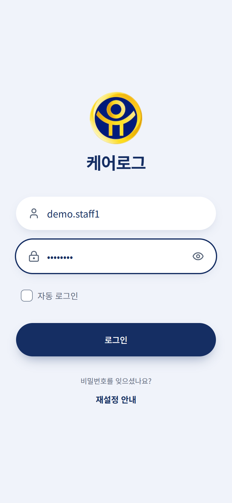 | 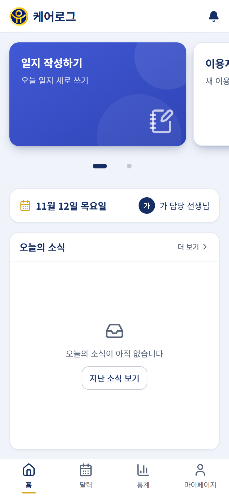 | <a href="docs/readme/03-activity-form-full.png">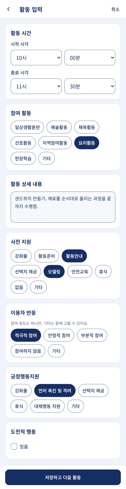</a> | <a href="docs/readme/04-diary-form-full.png">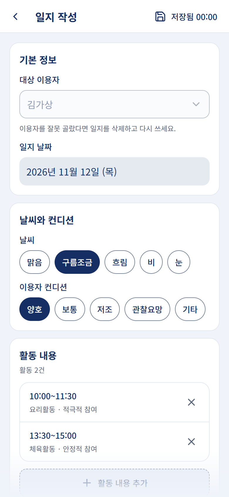</a> |
|         자동 로그인을<br>고를 수 있어요          |               오늘 쓸 일지와 소식               |                                     시간·참여 활동·<br>지원·반응 선택 🔍                                     |                                활동 2건을 넣고<br>특이사항을 적어요 🔍                                 |

|                        ⑤ 작성 완료                        |                                                ⑥ 일지 상세                                                 |                       ⑦ 달력                        |                                        ⑧ 통계 (연간)                                         |
| :-------------------------------------------------------: | :--------------------------------------------------------------------------------------------------------: | :-------------------------------------------------: | :------------------------------------------------------------------------------------------: |
| 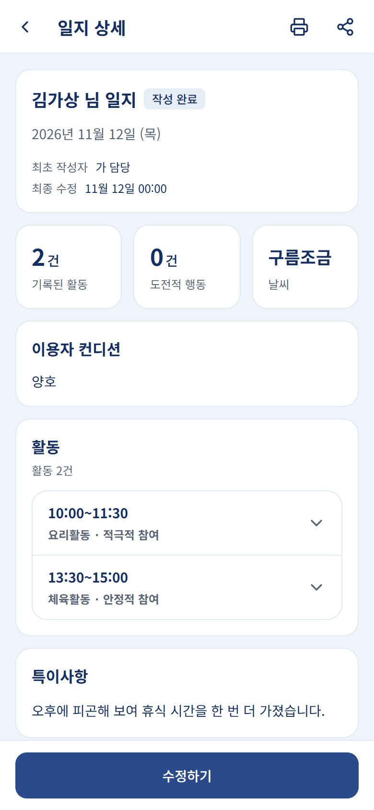 | <a href="docs/readme/06-diary-detail-full.png">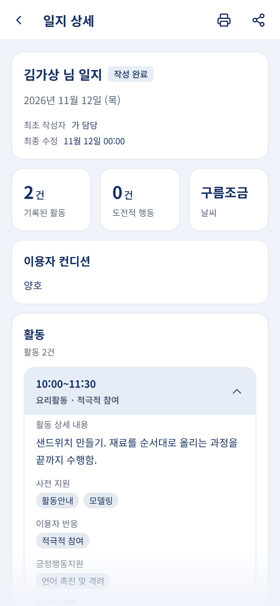</a> | 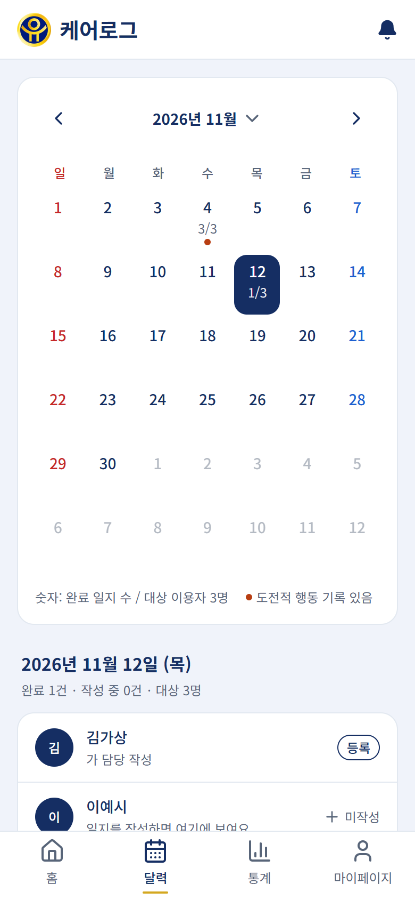 | <a href="docs/readme/08-stats-full.png">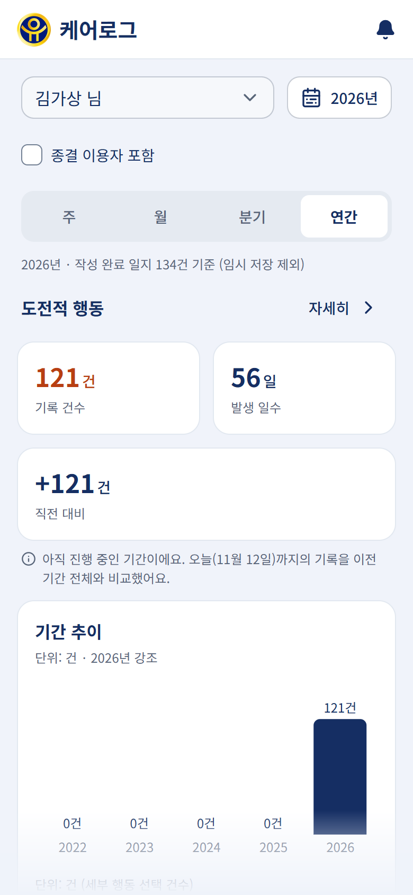</a> |
|              서버에 저장되고<br>상세로 이동               |                                    작성자, 수정 시각,<br>활동별 기록 🔍                                    |        날짜별 완료 수와<br>도전적 행동 표시         |                             4~11월 가상 일지로<br>계산한 통계 🔍                             |

PC에서는 하단 메뉴가 왼쪽 메뉴로 바뀝니다.

|                       홈 (1440px)                       |                      통계 (1440px)                       |
| :-----------------------------------------------------: | :------------------------------------------------------: |
| 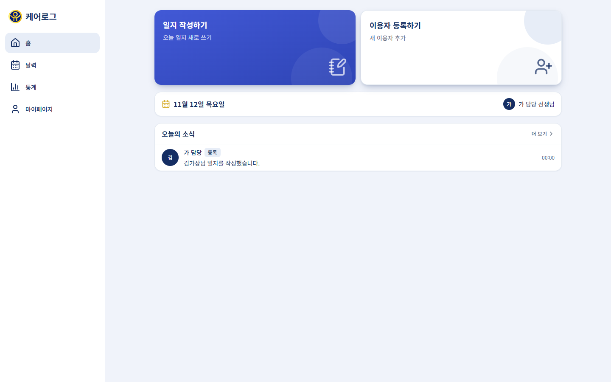 | 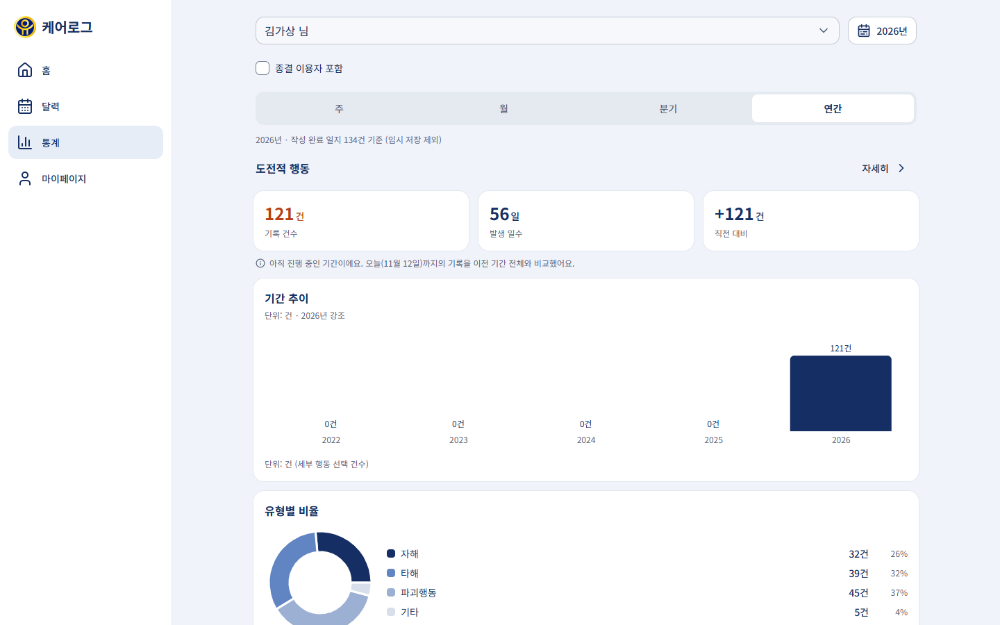 |

### 2. 오류 처리

화면에서 먼저 막고 이유를 알려 줍니다. 화면을 거치지 않은 요청은 서버가 다시 검사합니다.

|                      로그인 실패                       |                     시간 순서 오류                     |                      입력 중 나가기                       |                     활동 없이 완료                      |
| :----------------------------------------------------: | :----------------------------------------------------: | :-------------------------------------------------------: | :-----------------------------------------------------: |
| 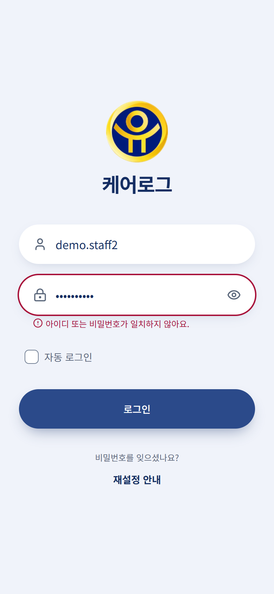 | 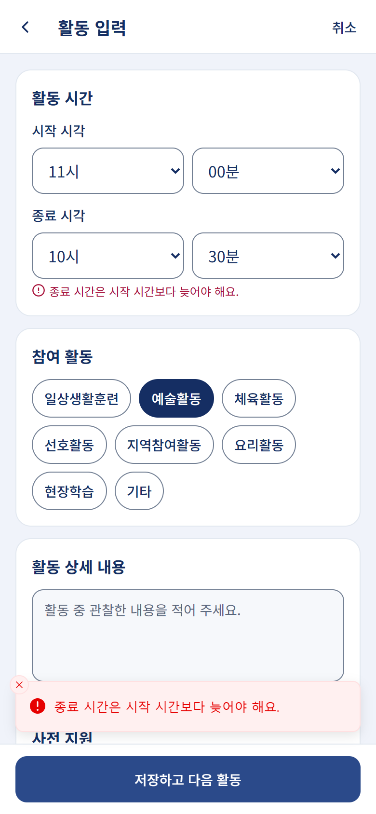 | 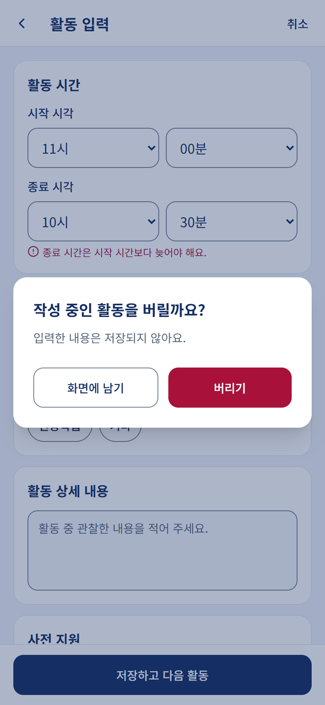 | 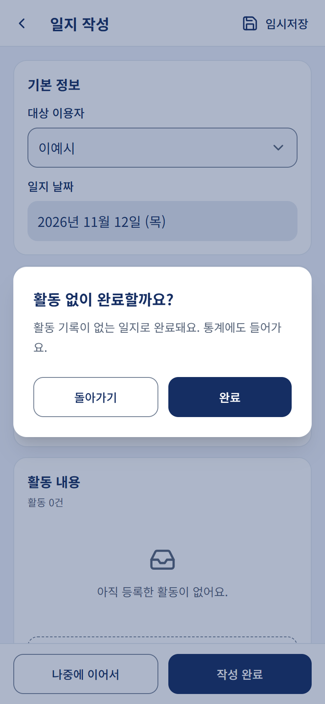 |
|         어느 쪽이 틀렸는지<br>알려 주지 않아요         |          종료가 시작보다<br>빠르면 저장 안 됨          |              입력이 있으면<br>버릴지 물어요               |              실수인지 한 번 더<br>확인해요              |

|                       하루 1건 규칙                        |                        미래 날짜                        |                       조회 실패                       |                       저장 실패                        |
| :--------------------------------------------------------: | :-----------------------------------------------------: | :---------------------------------------------------: | :----------------------------------------------------: |
| 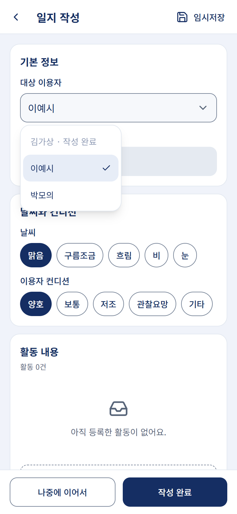 | 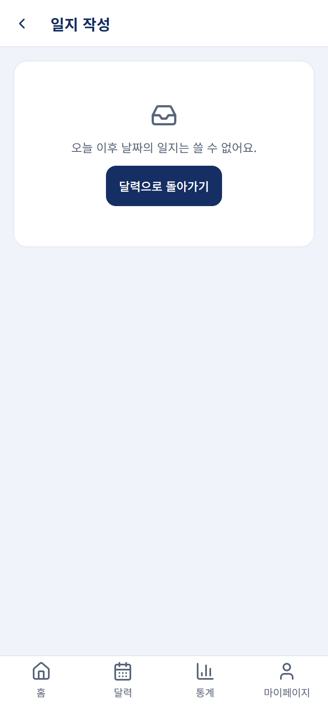 | 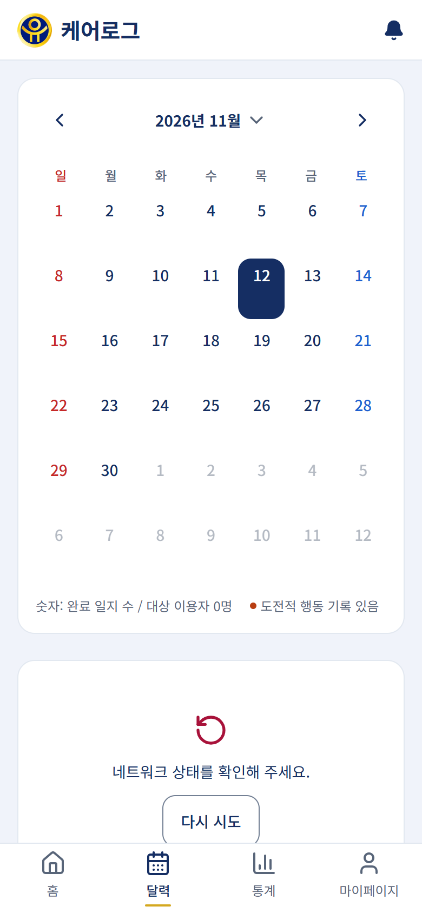 | 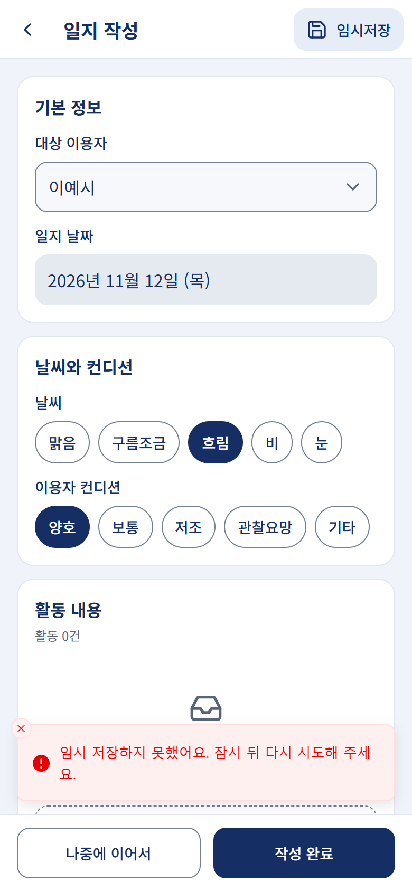 |
|           이미 완료한 이용자는<br>고를 수 없어요           |            오늘 이후 일지는<br>쓸 수 없어요             |             다시 시도 버튼을<br>보여 줘요             |         입력은 화면에 남기고<br>실패를 알려요          |

|                    동시 수정 충돌                    |                         첫 로그인                          |                      일반 직원 메뉴                      |                                                 팀장 메뉴                                                  |
| :--------------------------------------------------: | :--------------------------------------------------------: | :------------------------------------------------------: | :--------------------------------------------------------------------------------------------------------: |
| 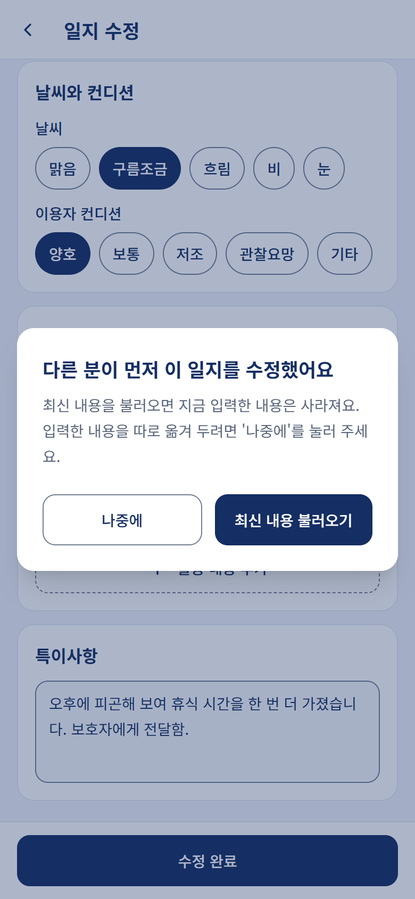 | 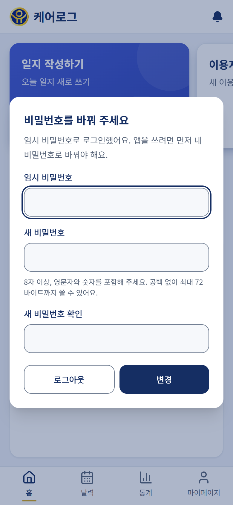 | 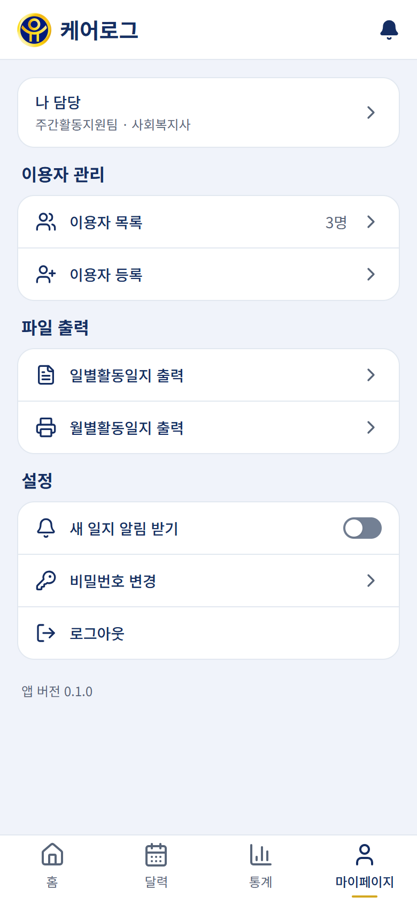 | <a href="docs/readme/e09-mypage-lead-full.png">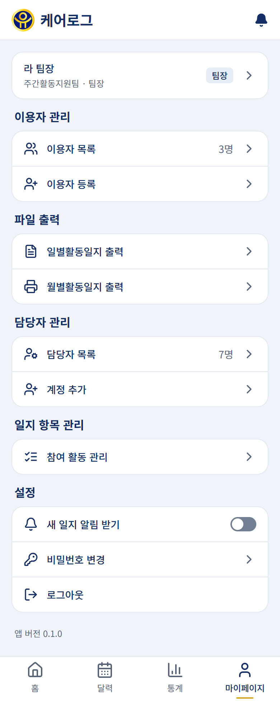</a> |
|        다른 사람이 먼저<br>저장했으면 막아요         |            바꾸기 전에는<br>창을 닫을 수 없어요            |               관리 메뉴가<br>보이지 않아요               |                                    담당자·항목 관리<br>메뉴가 보여요 🔍                                    |

조회 실패·저장 실패는 브라우저에서 해당 요청만 끊어 재현했습니다.

화면을 거치지 않고 API를 직접 호출해도 서버가 막습니다.

```text
# 로그인 없이 일지 조회
{"message":"로그인이 필요해요.","code":"UNAUTHENTICATED"}  → HTTP 401
# 일반 직원이 계정 추가 API를 직접 호출
{"message":"계정 추가는 팀장·국장만 할 수 있어요.","code":"FORBIDDEN"}  → HTTP 403
# 작성 완료된 일지 삭제 시도
{"message":"작성 완료된 일지는 삭제할 수 없어요.","code":"VALIDATION_ERROR"}  → HTTP 400
```

### 3. 데이터 저장

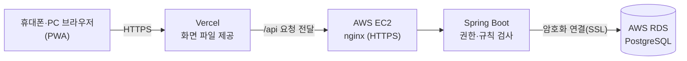

- 일지 내용은 서버 DB에만 저장합니다. 브라우저 저장소(localStorage)에는 일지 내용을 남기지 않습니다.
- DB는 외부에서 직접 접속할 수 없고, 서버만 접근합니다.
- 비밀번호는 BCrypt 해시로만 저장합니다.

**입력이 사라지지 않게 하는 장치**

|                             자동 임시저장                              |                       새로고침 뒤 복원                        |
| :--------------------------------------------------------------------: | :-----------------------------------------------------------: |
|         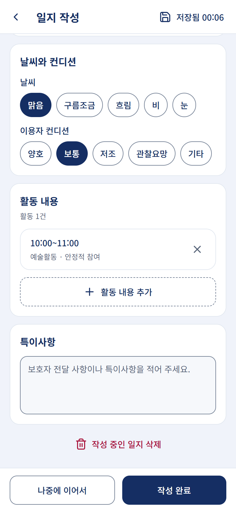          |     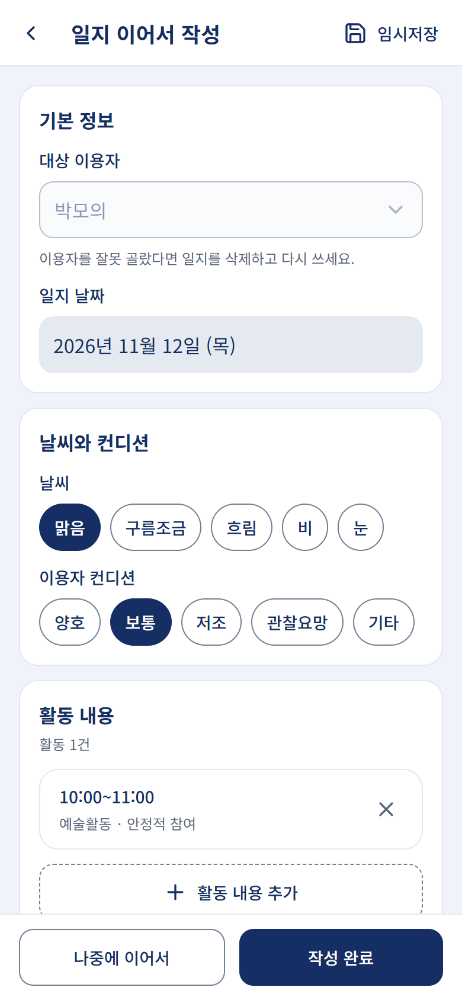      |
| 입력이 2초 멈추면<br>서버에 '작성 중'으로<br>저장하고 시각을 보여 줘요 | 새로고침해도 서버에<br>저장된 작성 중 일지를<br>다시 불러와요 |

**DB에 실제로 저장된 모습**

위 1번 흐름에서 쓴 일지가 DB에 어떻게 들어갔는지 조회한 결과입니다. 그 뒤 팀장이 특이사항을 고친 기록까지 이력에 남습니다.

```text
-- 1) 일지 한 건 (daily_log)
 log_id | 이용자 |  log_date  |  status   | 작성자  |                            특이사항                             |  수정시각
--------+--------+------------+-----------+---------+-----------------------------------------------------------------+-------------
    393 | 김가상 | 2026-11-12 | completed | 가 담당 | 오후에 피곤해 보여 휴식 시간을 한 번 더 가졌습니다. (팀장 확인) | 11-12 00:04

-- 2) 그 일지의 활동 (activity_record + 선택 항목 테이블)
 record_id |    시간     |                           활동내용                            | 참여활동
-----------+-------------+---------------------------------------------------------------+----------
       809 | 10:00~11:30 | 샌드위치 만들기. 재료를 순서대로 올리는 과정을 끝까지 수행함. | 요리활동
       810 | 13:30~15:00 | 공 주고받기 10회. 중간에 한 번 쉬고 다시 참여함.              | 체육활동

-- 3) 등록·수정 이력 (log_history)
  kind   |  누가   |      언제
---------+---------+----------------
 created | 가 담당 | 11-12 00:00:16
 updated | 라 팀장 | 11-12 00:04:56
```

- 활동의 선택 항목(참여 활동·사전 지원·반응·긍정행동지원·도전적 행동)은 항목별 테이블에 코드로 저장합니다. 그래서 통계를 글자가 아닌 코드로 셉니다.
- 동시 수정은 마지막으로 읽은 수정 시각(`updatedAt`)을 함께 보내서, 그사이 다른 사람이 저장했으면 서버가 거절합니다(위 2번 '동시 수정 충돌').

### 4. 공유 과정

**팀 안에서**: 담당자가 쓴 일지는 같은 팀 모두가 바로 봅니다.

|                        팀장 홈                        |                        오늘의 소식                        |                       계정 추가                       |                    임시 비밀번호 전달                     |
| :---------------------------------------------------: | :-------------------------------------------------------: | :---------------------------------------------------: | :-------------------------------------------------------: |
| 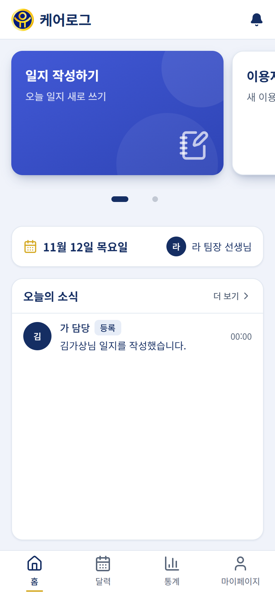 | 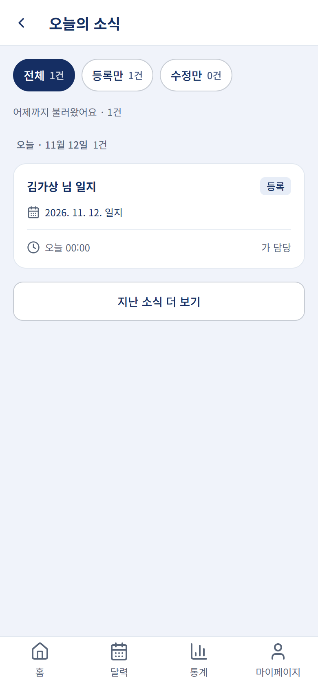 | 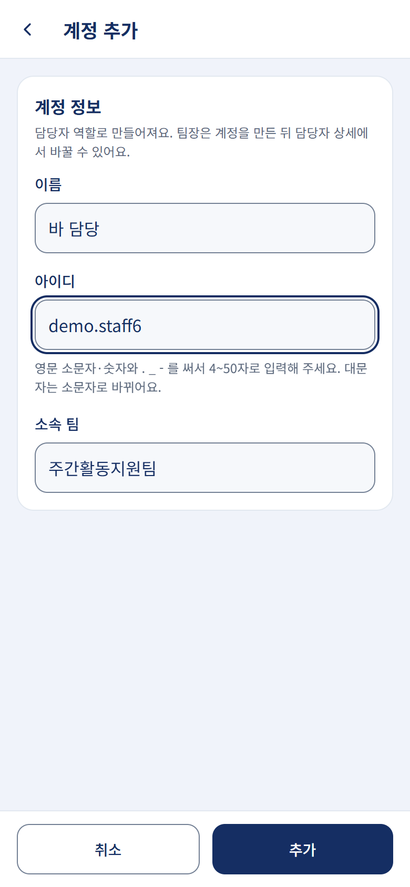 | 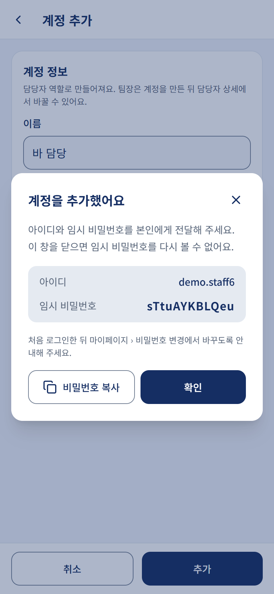 |
|        `가 담당`이 쓴 일지가<br>팀장 홈에 떠요        |         누가 어떤 일지를<br>등록·수정했는지 봐요          |            팀장·국장이<br>계정을 만들어요             |         한 번만 보여 주고<br>첫 로그인 때 바꿔요          |

**기관 밖으로**: 기관 양식(docx)으로 내려받아 보고·보관합니다.

|                    월별활동일지 출력                    |                                                 일별활동일지 (docx)                                                 |
| :-----------------------------------------------------: | :-----------------------------------------------------------------------------------------------------------------: |
| 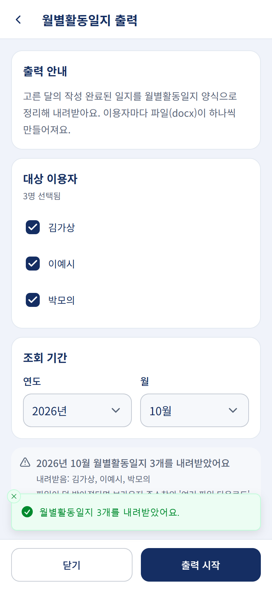 | 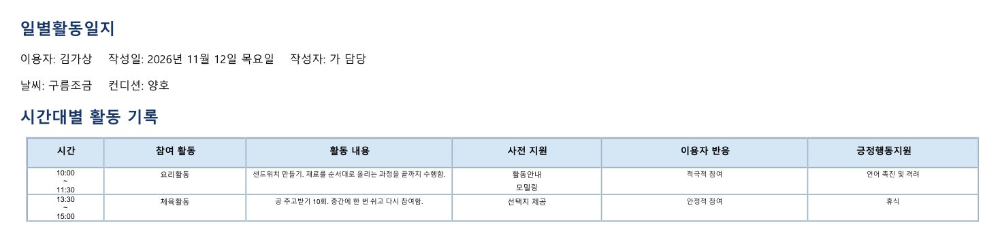<br>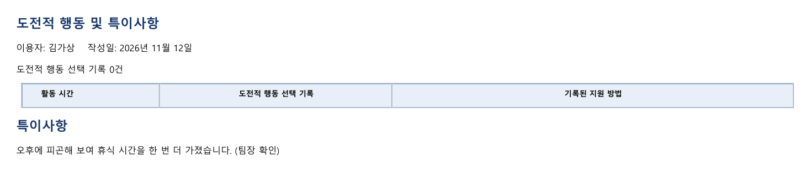 |
|           이용자 3명의 10월<br>파일을 한 번에           |                                      일지 상세의 인쇄<br>버튼으로 바로 받아요                                       |

|            월별활동일지 (docx) — 날짜별 기록             |                                                     월간 요약과 그래프                                                     |
| :------------------------------------------------------: | :------------------------------------------------------------------------------------------------------------------------: |
| 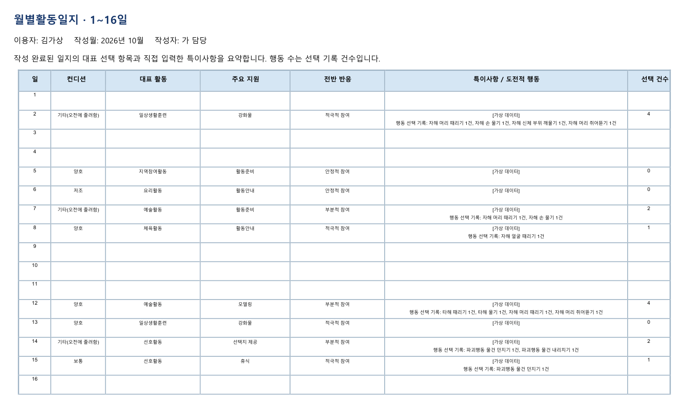 | 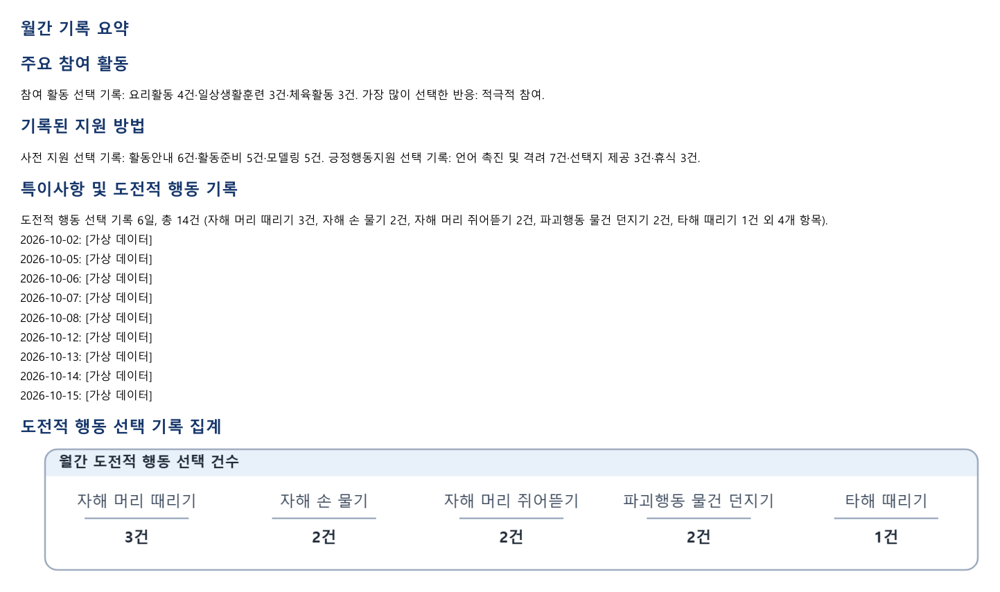<br>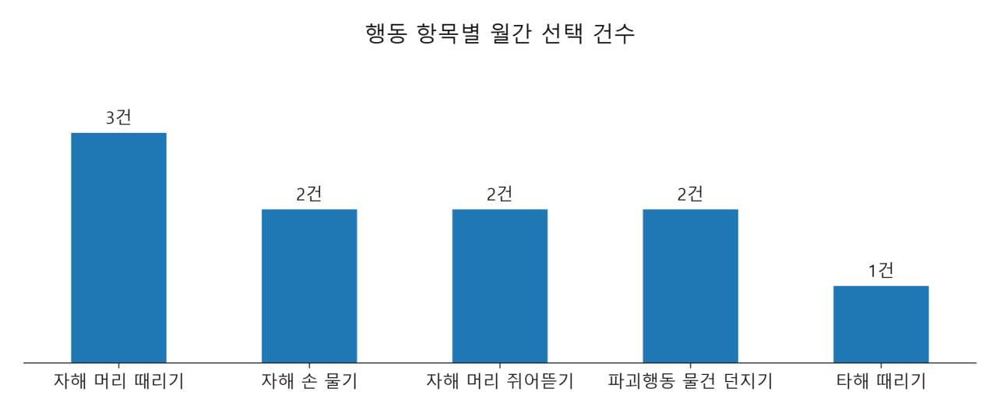 |

내려받은 docx를 Word에서 연 그대로입니다. 그래프는 통계와 같은 계산으로 만들어 양식에 끼워 넣습니다.

### 5. 안정성

2026-11-12에 실행한 결과입니다.

| 검사                                       | 내용                                                          | 결과                        |
| ------------------------------------------ | ------------------------------------------------------------- | --------------------------- |
| 프론트 브라우저 테스트 (`npm run test:qa`) | 실제 Chromium에서 화면 크기·역할·오류 응답·날짜 경계별로 실행 | **372개 모두 통과** (3.8분) |
| 프론트 빌드·데이터 검증 (`npm run verify`) | 타입 검사, 통계 계산, 실제 docx 생성 결과 검사                | **모두 통과**               |
| 백엔드 테스트 (`./gradlew test`)           | 권한·검증 규칙, PostgreSQL 저장·조회 왕복                     | **206개 모두 통과**         |

- **자동 배포**: 백엔드는 main에 합치면 GitHub Actions가 테스트를 먼저 돌리고, 통과해야만 EC2에 배포합니다. 프론트는 main에 합치면 Vercel이 다시 빌드해 배포합니다.
- **앱 업데이트**: 새 버전이 배포되면 앱에서 '새 버전이 있어요' 안내를 띄웁니다.

## 코드 구조

```text
src/
  api/          서버 계약, HTTP 클라이언트, 조회·저장 훅과 캐시 갱신
  app/          라우팅·인증·권한, DraftContext, StatsContext, useStatsSummary
  components/   공용 UI, 레이아웃, 선택 칩, 활동 시간, 달력·통계
  pages/        auth, home, diary, calendar, stats, manage, mypage, export
  services/     일지·통계·출력 계산, 계정 검증, 시간·출력 범위 검사
  data/         기본 선택 항목(서버 응답 전 fallback)
  lib/export/   docx 생성·다운로드·월간 차트
  assets/forms/ 원본·출력 템플릿
scripts/        계산 검증, fixture, prepare와 템플릿 생성
 tests/         항목별 계산·브라우저 회귀 검증
```

RadioGroup은 담당자 역할 변경에서 사용 중입니다. 공용 컴포넌트 정리 시 사용처를 확인하세요.
API 경로·필드 변경 시 [api/types.ts](src/api/types.ts), [httpApi.ts](src/api/http/httpApi.ts), [queries.ts](src/api/queries.ts)와 [연동 문서](docs/backend-integration.md)를 함께 갱신합니다.
