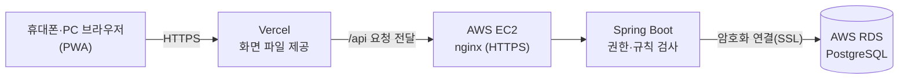

# welfare-fe — 케어로그

복지관 돌봄 일지 작성·인수인계 앱입니다. React 19, TypeScript, Vite, Tailwind CSS, React Router, TanStack Query를 사용합니다.

화면은 실제 백엔드 `welfare-be`를 호출합니다. 브라우저 mock 서버는 없으며 백엔드와 PostgreSQL이 실행되어 있어야 합니다.

- [실제 화면이 포함된 사용자 매뉴얼 PDF](docs/케어로그_사용자매뉴얼.pdf)
- [수정 전후와 기능·코드 개선점](docs/초기-main-수정전후와-개선점.md)
- [main 통합 변경 사항](docs/main-update-2026-11-07.md)

## 동작 확인

**배포 주소: <https://welfare-fe.vercel.app>**

아래 화면은 배포본과 같은 코드를 로컬 서버와 로컬 PostgreSQL에서 실행해 찍었습니다(2026-11-12). 이용자·직원은 모두 가상 데이터입니다. 운영 DB에는 실제 이용자 기록이 있어 공개 문서에 쓰지 않았습니다.

| 확인할 것 | 보여 주는 내용 |
|---|---|
| [1. 실제 작동](#1-실제-작동) | 로그인부터 일지 작성·완료, 달력, 통계, 출력까지 이어지는 흐름 |
| [2. 오류 처리](#2-오류-처리) | 잘못된 입력·접근·충돌·연결 실패를 어떻게 막고 안내하는가 |
| [3. 데이터 저장](#3-데이터-저장) | 어디에 어떻게 저장되고, 입력이 사라지지 않게 어떻게 지키는가 |
| [4. 공유 과정](#4-공유-과정) | 쓴 기록이 팀장·동료와 문서로 어떻게 전달되는가 |
| [5. 안정성](#5-안정성) | 자동 테스트 결과와 배포 과정 |

### 1. 실제 작동

담당자 `가 담당`이 이용자 `김가상`의 오늘 일지를 쓰고 완료하는 흐름입니다.

| ① 로그인 | ② 홈 | ③ 활동 입력 | ④ 일지 작성 |
|:-:|:-:|:-:|:-:|
|  |  |  |  |
| 자동 로그인을 고를 수 있어요 | 오늘 쓸 일지와 소식 | 시간·참여 활동·지원·반응을 골라요 | 활동 2건을 넣고 특이사항을 적어요 |

| ⑤ 작성 완료 | ⑥ 일지 상세 | ⑦ 달력 | ⑧ 통계 (연간) |
|:-:|:-:|:-:|:-:|
|  |  |  |  |
| 서버에 저장되고 상세로 이동 | 작성자·수정 시각·활동별 기록 | 날짜별 완료 수와 도전적 행동 표시 | 4~11월 가상 일지로 계산한 통계 |

PC에서는 하단 메뉴가 왼쪽 메뉴로 바뀝니다.

| 홈 (1440px) | 통계 (1440px) |
|:-:|:-:|
|  |  |

### 2. 오류 처리

화면에서 먼저 막고 이유를 알려 줍니다. 화면을 거치지 않은 요청은 서버가 다시 검사합니다.

| 로그인 실패 | 시간 순서 오류 | 입력 중 나가기 | 활동 없이 완료 |
|:-:|:-:|:-:|:-:|
|  |  |  |  |
| 어느 쪽이 틀렸는지 알려 주지 않아요 | 종료가 시작보다 빠르면 저장 안 됨 | 입력이 있으면 버릴지 물어요 | 실수인지 한 번 더 확인해요 |

| 하루 1건 규칙 | 미래 날짜 | 조회 실패 | 저장 실패 |
|:-:|:-:|:-:|:-:|
|  |  |  |  |
| 이미 완료한 이용자는 고를 수 없어요 | 오늘 이후 일지는 쓸 수 없어요 | 다시 시도 버튼을 보여 줘요 | 입력은 화면에 남기고 실패를 알려요 |

| 동시 수정 충돌 | 첫 로그인 비밀번호 변경 | 일반 직원 메뉴 | 팀장 메뉴 |
|:-:|:-:|:-:|:-:|
|  |  |  |  |
| 다른 사람이 먼저 저장했으면 덮어쓰지 않아요 | 임시 비밀번호로는 앱을 쓸 수 없어요. 닫기·바깥 클릭이 막혀 있어요 | 담당자·항목 관리 메뉴가 없어요 | 담당자 관리와 일지 항목 관리가 보여요 |

조회 실패·저장 실패는 브라우저에서 해당 요청만 끊어 재현했습니다.

화면을 거치지 않고 API를 직접 호출해도 서버가 막습니다.

```text
# 로그인 없이 일지 조회
{"message":"로그인이 필요해요.","code":"UNAUTHENTICATED"}  → HTTP 401
# 일반 직원이 계정 추가 API를 직접 호출
{"message":"계정 추가는 팀장·국장만 할 수 있어요.","code":"FORBIDDEN"}  → HTTP 403
# 작성 완료된 일지 삭제 시도
{"message":"작성 완료된 일지는 삭제할 수 없어요.","code":"VALIDATION_ERROR"}  → HTTP 400
```

### 3. 데이터 저장



- 일지 내용은 서버 DB에만 저장합니다. 브라우저 저장소(localStorage)에는 일지 내용을 남기지 않습니다.
- DB는 외부에서 직접 접속할 수 없고, 서버만 접근합니다.
- 비밀번호는 BCrypt 해시로만 저장합니다.

**입력이 사라지지 않게 하는 장치**

| 자동 임시저장 | 새로고침 뒤 복원 |
|:-:|:-:|
|  |  |
| 입력이 2초 멈추면 서버에 '작성 중'으로 저장하고 시각을 보여 줘요 | 새로고침해도 서버에 저장된 작성 중 일지를 다시 불러와요 |

**DB에 실제로 저장된 모습**

위 1번 흐름에서 쓴 일지가 DB에 어떻게 들어갔는지 조회한 결과입니다. 그 뒤 팀장이 특이사항을 고친 기록까지 이력에 남습니다.

```text
-- 1) 일지 한 건 (daily_log)
 log_id | 이용자 |  log_date  |  status   | 작성자  |                            특이사항                             |  수정시각
--------+--------+------------+-----------+---------+-----------------------------------------------------------------+-------------
    393 | 김가상 | 2026-11-12 | completed | 가 담당 | 오후에 피곤해 보여 휴식 시간을 한 번 더 가졌습니다. (팀장 확인) | 11-12 00:04

-- 2) 그 일지의 활동 (activity_record + 선택 항목 테이블)
 record_id |    시간     |                           활동내용                            | 참여활동
-----------+-------------+---------------------------------------------------------------+----------
       809 | 10:00~11:30 | 샌드위치 만들기. 재료를 순서대로 올리는 과정을 끝까지 수행함. | 요리활동
       810 | 13:30~15:00 | 공 주고받기 10회. 중간에 한 번 쉬고 다시 참여함.              | 체육활동

-- 3) 등록·수정 이력 (log_history)
  kind   |  누가   |      언제
---------+---------+----------------
 created | 가 담당 | 11-12 00:00:16
 updated | 라 팀장 | 11-12 00:04:56
```

- 활동의 선택 항목(참여 활동·사전 지원·반응·긍정행동지원·도전적 행동)은 항목별 테이블에 코드로 저장합니다. 그래서 통계를 글자가 아닌 코드로 셉니다.
- 동시 수정은 마지막으로 읽은 수정 시각(`updatedAt`)을 함께 보내서, 그사이 다른 사람이 저장했으면 서버가 거절합니다(위 2번 '동시 수정 충돌').

### 4. 공유 과정

**팀 안에서**: 담당자가 쓴 일지는 같은 팀 모두가 바로 봅니다.

| 팀장 홈 | 오늘의 소식 | 계정 추가 | 임시 비밀번호 전달 |
|:-:|:-:|:-:|:-:|
|  |  |  |  |
| `가 담당`이 쓴 일지가 팀장 홈에 떠요 | 누가 어떤 일지를 등록·수정했는지 모아 봐요 | 회원가입 없이 팀장·국장이 계정을 만들어요 | 한 번만 보여 주고, 첫 로그인 때 바꾸게 해요 |

**기관 밖으로**: 기관 양식(docx)으로 내려받아 보고·보관합니다.

| 월별활동일지 출력 | 일별활동일지 (docx) |
|:-:|:-:|
|  | <br> |
| 이용자 3명의 10월 파일을 한 번에 | 일지 상세의 인쇄 버튼으로 바로 받아요 |

| 월별활동일지 (docx) — 날짜별 기록 | 월간 요약과 그래프 |
|:-:|:-:|
|  | <br> |

내려받은 docx를 Word에서 연 그대로입니다. 그래프는 통계와 같은 계산으로 만들어 양식에 끼워 넣습니다.

### 5. 안정성

2026-11-12에 실행한 결과입니다.

| 검사 | 내용 | 결과 |
|---|---|---|
| 프론트 브라우저 테스트 (`npm run test:qa`) | 실제 Chromium에서 화면 크기·역할·오류 응답·날짜 경계별로 실행 | **372개 모두 통과** (3.8분) |
| 프론트 빌드·데이터 검증 (`npm run verify`) | 타입 검사, 통계 계산, 실제 docx 생성 결과 검사 | **모두 통과** |
| 백엔드 테스트 (`./gradlew test`) | 권한·검증 규칙, PostgreSQL 저장·조회 왕복 | **206개 모두 통과** |

- **자동 배포**: 백엔드는 main에 합치면 GitHub Actions가 테스트를 먼저 돌리고, 통과해야만 EC2에 배포합니다. 프론트는 main에 합치면 Vercel이 다시 빌드해 배포합니다.
- **앱 업데이트**: 새 버전이 배포되면 앱에서 '새 버전이 있어요' 안내를 띄웁니다.

## 실행

Node.js 20 이상과 npm이 필요합니다. 특정 PC의 포터블 Node 경로를 전제로 하지 않습니다.

```powershell
cd welfare-fe
npm ci
npm run dev
```

개발 서버는 `http://localhost:5173`입니다. 같은 와이파이의 휴대폰은 Vite가 출력하는 Network 주소로 접속합니다.
`/api` 요청은 기본적으로 `http://localhost:8080`으로 전달합니다. 주소 변경은 [.env.example](.env.example)을 참고해 `.env`의 `VITE_API_PROXY_TARGET`을 설정하세요.

Git이 없는 ZIP 폴더에서도 설치할 수 있습니다. [prepare.mjs](scripts/prepare.mjs)는 저장소일 때 Git hook을 설정하며, Git 설정 실패가 의존성 설치를 중단시키지 않습니다. 검증 스크립트가 직접 사용하는 esbuild는 개발 의존성으로 선언되어 있습니다.

## 검증

```powershell
npm run build       # 타입 검사 + 배포 빌드
npm run check:data  # 통계·날짜·소식·달력·실제 docx 생성 검증
npm run verify      # build + check:data
npx playwright install chromium  # 브라우저 검증 최초 1회 준비
npm run test:qa     # 문제 번호별 회귀 검증
npx playwright test tests/report-forms.spec.ts --config playwright.preview.config.ts  # build 후 배포 자산으로 출력 검증
```

[tests](tests/)는 실제 Chromium에서 화면을 실행하고 네트워크 경계의 API 응답을 제어합니다. 계산 및 문서 검증도 포함하며, 브라우저 런타임 오류가 발생하면 실패합니다. 화면 크기, 역할, 오류 응답, 날짜·시간 경계, 기존 데이터 등 서로 다른 케이스를 검증합니다. 운영 서버에 데이터를 쓰지 않습니다.

결과는 `test-results/results.json`, 실패 시 trace와 화면 상태는 `test-results/`에 남습니다. 실제 서버·DB 검증은 백엔드의 `PostgresRoundTripTest`를 함께 실행하세요. 브라우저 가상 API 검증을 서버 연동 성공으로 간주하지 않습니다.

배포 출력 검증은 4174 포트의 `vite preview`를 사용하며 `test-results/preview-results.json`에 결과를 남깁니다. 실행 전에 `npm run build` 또는 `npm run verify`로 최신 배포 파일을 만들어야 합니다.

## 현재 동작

- **인증**: 쿠키 세션입니다. 자동 로그인 해제 시 1시간의 서버 세션과 세션 쿠키, 선택 시 30일의 서버 세션과 영속 쿠키를 사용합니다. 서버 재시작 후 세션 복원은 별도 기능입니다. 브라우저 자체의 이전 세션 복원 설정에도 영향을 받을 수 있습니다.
- **계정**: 회원가입은 없습니다. 팀장·국장이 담당자 계정을 만들고 임시 비밀번호 팝업으로 전달합니다. 아이디는 소문자로 정규화하며 4~50자의 영문·숫자·점·밑줄·붙임표를 허용합니다.
- **비밀번호**: 8자 이상, 영문자·숫자 포함, 공백 금지, UTF-8 72바이트 이하입니다. 변경하면 세션과 작성 중 입력을 비우고 다시 로그인합니다.
- **일지**: 이용자 한 명당 하루 한 건입니다. 미래 날짜는 작성할 수 없습니다. 작성 중 → 작성 완료로만 전환하고 완료 일지는 완료 상태로 수정합니다.
- **임시저장**: 상단 버튼은 실제 서버에 작성 중 상태로 저장합니다. 입력이 2초 멈추거나 화면이 가려질 때 자동 저장합니다. 저장 여부에 맞게 안내하며 내용이 없거나 실패한 경우 성공 메시지를 띄우지 않습니다.
- **입력 보호**: 새로고침·탭 닫기 전 미저장 경고, pagehide keepalive 저장, 저장된 작성 중 일지 ID를 통한 복원을 사용합니다. 일지 내용은 localStorage에 보관하지 않습니다. 완료 일지 수정은 자동 저장 대신 이탈 경고로 보호합니다.
- **작성 중 일지 삭제**: 작성자 또는 팀장·국장이 삭제할 수 있습니다. 완료 일지는 삭제할 수 없습니다.
- **활동 시간**: 00:00~24:00에서 시작·종료를 각각 분 단위로 선택합니다. 24:00은 종료에만 허용합니다. 종료는 시작보다 늦어야 하며 같은 일지 안에서 시간이 겹칠 수 없습니다. 자정을 넘는 활동은 날짜별로 나눠 기록합니다.
- **이용자 반응**: 참여 정도는 1개만, 기타는 별도로 함께 선택할 수 있습니다. 과거 복수 참여 정도는 하나를 다시 선택해야 저장할 수 있습니다. 긍정행동지원은 복수 선택을 유지합니다.
- **동시 수정**: 마지막으로 읽은 updatedAt을 보내고, 다른 사람이 먼저 저장했으면 서버가 409로 거절합니다. 입력을 유지하거나 확인 후 최신 내용을 불러옵니다.
- **관리 화면**: `/staff`, `/staff/new`, `/staff/:id`, `/settings/participation`은 팀장·국장만 진입합니다. 서버도 관리 작업의 권한을 검사합니다. 일반 직원의 일지 작성자·담당 직원 표시를 위해 직원 목록 조회 API는 유지합니다.
- **이용자 종결·재개**: 팀장·국장만 할 수 있습니다. 종결은 삭제가 아니며 같은 이용자 ID로 이용을 재개합니다. 일반 직원도 과거 기록을 조회할 수 있습니다.

## 통계

통계 화면은 서버의 `GET /api/stats/summary` 응답을 사용합니다. [useStatsSummary](src/app/useStatsSummary.ts)가 조회를 연결하며 [statsService](src/services/statsService.ts)는 기간 계산, 빈 초기값, 출력 계산과 검증에 사용합니다.

- 완료 일지만 집계합니다. 임시저장은 제외합니다.
- 도전적 행동은 활동 안의 동일 유형·세부 행동을 1건으로 셉니다. 빈 상위 기타는 제외합니다. 일일·월간 기록과 통계가 같은 [behaviorEntries](src/services/diaryService.ts)를 사용합니다.
- 이전 기간 완료 일지가 없을 때만 기록 없음으로 표시합니다. 행동만 0건이면 증감을 계산합니다. 진행 중인 기간은 이전 기간 전체와 비교한다는 안내를 보여 줍니다.
- 주간은 월 경계와 관계없이 일요일~토요일 7일입니다. 이전 기간은 실제 시작일에서 7일 전이므로 월 경계의 같은 주를 중복 비교하지 않습니다.
- 추이는 주·월 6구간, 분기 4구간, 연 5구간입니다.
- 참여 활동 선택지는 서버 목록을 사용하며 기본 활동은 기록이 가장 많은 항목입니다. 같은 조회 범위에서 사용자가 명시적으로 선택한 활동은 유지합니다.
- 종결 이용자 포함을 선택하면 과거 통계를 조회할 수 있습니다. 종결 이용자 상세의 지난 통계 보기로 바로 진입할 수도 있습니다.
- 존재하지 않는 통계 분류 주소는 찾을 수 없는 화면으로 표시합니다. 조회 실패·로딩 중에는 0건 기준 안내를 보여 주지 않습니다.

## 출력

일별활동일지와 월별활동일지를 브라우저에서 docx로 생성합니다. 제공된 양식에서 앱에 입력 항목이 없는 목표·결과/변화·선행사건·인수인계·평가 항목을 제거했습니다. 템플릿은 [src/assets/forms](src/assets/forms/)에 있습니다.

- 일지 모음은 이용자 한 명의 완료 일지를 날짜순으로 묶고, 최대 92일·오늘까지의 범위를 허용합니다.
- 월간 문장과 차트의 숫자 단위는 건입니다. 행동 이름에는 자해·타해·파괴행동 등 영역을 표시합니다.
- 파일 이름은 `이용자이름_날짜_일별활동일지.docx`, `이용자이름_시작일~종료일_일별활동일지.docx`, `이용자이름_연월_월별활동일지.docx`입니다.
- 마이페이지의 ‘일별활동일지 출력’은 기간 내 작성 완료 일지를 날짜순으로 모읍니다. ‘월별활동일지 출력’은 이용자별 월간 파일을 만듭니다. 작성자 이름은 실제 작성자 정보에서 찾으며, 특이사항은 입력 원문을 보존합니다. 행동 건수는 선택 기록 수이며, 지원 효과나 실제 발생 횟수를 추정하지 않습니다.
- 원본 양식 변경 후 `node scripts/build-report-templates.cjs`로 출력용 템플릿을 다시 생성합니다.
- 엑셀 내보내기는 현재 메뉴에서 제거되어 있습니다. 별도 보고서 신규 기능은 포함하지 않습니다.

## 코드 구조

```text
src/
  api/          서버 계약, HTTP 클라이언트, 조회·저장 훅과 캐시 갱신
  app/          라우팅·인증·권한, DraftContext, StatsContext, useStatsSummary
  components/   공용 UI, 레이아웃, 선택 칩, 활동 시간, 달력·통계
  pages/        auth, home, diary, calendar, stats, manage, mypage, export
  services/     일지·통계·출력 계산, 계정 검증, 시간·출력 범위 검사
  data/         기본 선택 항목(서버 응답 전 fallback)
  lib/export/   docx 생성·다운로드·월간 차트
  assets/forms/ 원본·출력 템플릿
scripts/        계산 검증, fixture, prepare와 템플릿 생성
 tests/         항목별 계산·브라우저 회귀 검증
```

RadioGroup은 담당자 역할 변경에서 사용 중입니다. 공용 컴포넌트 정리 시 사용처를 확인하세요.
API 경로·필드 변경 시 [api/types.ts](src/api/types.ts), [httpApi.ts](src/api/http/httpApi.ts), [queries.ts](src/api/queries.ts)와 [연동 문서](docs/backend-integration.md)를 함께 갱신합니다.

## 개발 계정

백엔드 local 프로필의 개발용 가상 데이터 계정입니다. 비밀번호는 `demo1234`입니다. 운영 서버에는 없습니다.

| 아이디 | 역할 |
|---|---|
| demo.staff1 / demo.staff2 / demo.staff3 | 담당자 |
| demo.lead | 팀장 |
| demo.director | 국장 |

## PWA와 배포

[vite.config.ts](vite.config.ts)의 vite-plugin-pwa 설정과 [public/icons](public/icons/)를 사용합니다. 개발 서버에서는 서비스 워커를 켜지 않으므로 빌드 후 `npm run preview`로 확인합니다. HTTPS 또는 localhost가 필요합니다.
API 응답은 서비스 워커에 캐시하지 않습니다. 새 버전은 사용자가 새로고침을 선택할 때 적용합니다. 아이폰은 Safari 공유 메뉴에서 홈 화면에 추가합니다.

[vercel.json](vercel.json)은 정적 빌드 `dist`를 제공하고 `/api/*`를 백엔드로 전달합니다. 테스트 백엔드 주소를 바꾸면 이 파일을 함께 수정하세요. 브라우저가 같은 사이트의 API를 호출하도록 유지해야 Safari 쿠키가 정상 동작합니다.
이번 점검 수정은 로컬 작업이며 자동 배포·Git push는 실행하지 않습니다.
